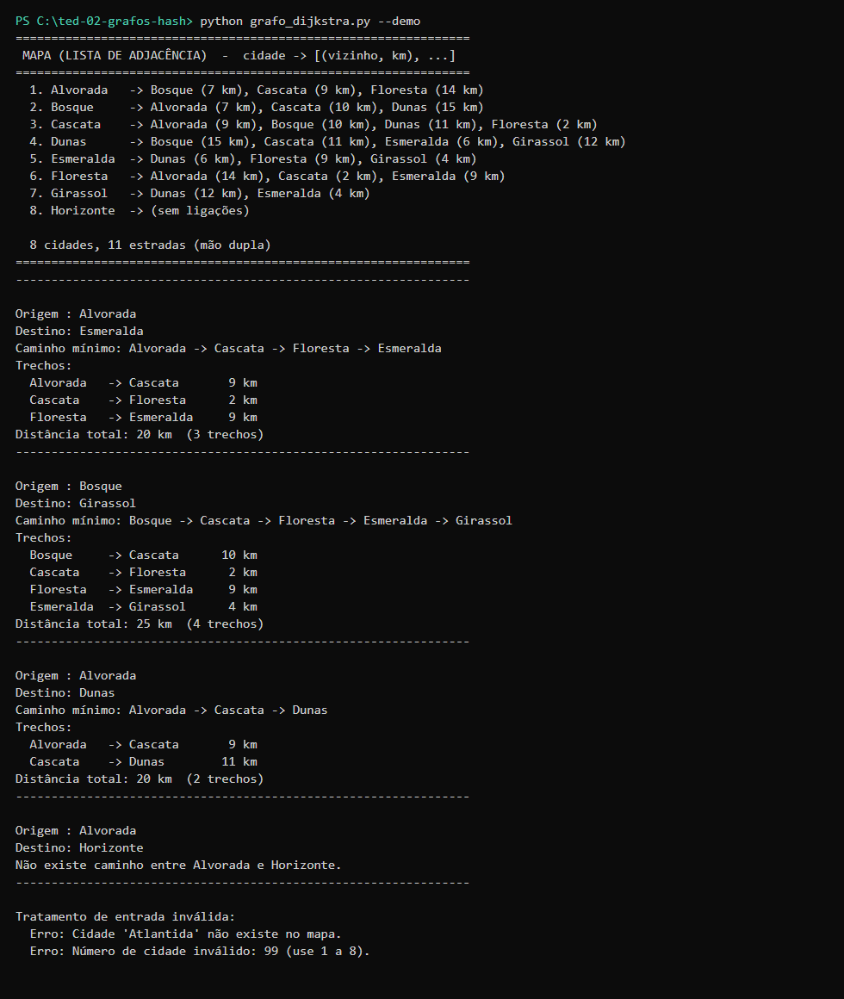

# TED 02 – Modelagem e Resolução Prática de Problemas com Grafos e Tabelas Hash

**Disciplina:** Estruturas Avançadas de Dados
**Atividade:** TED 02
**Integrantes da dupla:** Pedro Paulo Teixeira de Araújo; Rafael Pontara
**Entrega:** 25/11/2026

---

## Estrutura do repositório

```
ted-02-grafos-hash/
├── README.md                    # este arquivo
├── hash_frequencias.py          # Parte 1 – Tabela Hash: contagem de frequências
├── grafo_dijkstra.py            # Parte 2 – Grafo (lista de adjacência) + Dijkstra
├── dados/
│   └── texto_exemplo.txt        # texto de ~900 palavras usado na Parte 1
├── evidencias/                  # capturas (.png) e saídas completas (.txt)
│   ├── frequencias.png
│   ├── frequencias_exemplo_enunciado.png
│   ├── caminho_minimo.png
│   ├── caminho_minimo_nova_conexao.png
│   └── *.txt
└── docs/
    ├── documentacao.pdf         # documentação técnica
    ├── documentacao.html        # fonte da documentação
    └── banner.png               # banner usado na documentação
```

## Dependências

- **Python 3.8 ou superior.**
- Nenhuma biblioteca externa: são usados apenas módulos da biblioteca padrão
  (`re`, `argparse`, `pathlib`, `heapq`, `math`, `sys`). Não é preciso `pip install`.

## Parte 1 – Tabela Hash: contagem de frequências

O programa lê um texto, normaliza as palavras (minúsculas, sem pontuação e sem números)
e conta as ocorrências em um `dict` do Python, que é uma tabela hash. Depois lista
todas as palavras com suas frequências e mostra o ranking das mais frequentes.

```powershell
python hash_frequencias.py
```

| Opção | O que faz |
|---|---|
| `--arquivo caminho.txt` | analisa outro arquivo de texto (UTF-8) |
| `--texto "..."` | analisa um texto digitado na linha de comando |
| `--top N` | quantidade de palavras no ranking (padrão: 5) |
| `--sem-stopwords` | ignora palavras muito comuns (artigos, preposições...) |
| `--resumo` | mostra só o ranking, sem a lista completa |
| `--buscar p1 p2 ...` | consulta diretamente a frequência de palavras |

Exemplo do enunciado:

```powershell
python hash_frequencias.py --texto "dados estrutura dados grafo estrutura dados"
```

Resultado: `dados: 3`, `estrutura: 2`, `grafo: 1`.

**Por que tabela hash?** Cada palavra é uma chave. O hash da chave leva direto à posição
onde fica o contador, então buscar, inserir e atualizar custam **O(1) em média**. Contar
*n* palavras custa **O(n)**. Sem a tabela hash, cada palavra teria de ser comparada
com todas as já vistas, o que daria O(n·k). No pior caso, quando há muitas colisões,
uma operação pode chegar a O(k), mas o `dict` do Python redimensiona a tabela para
manter o custo médio constante.

## Parte 2 – Grafo e caminho mínimo (Dijkstra)

Mapa fictício com **8 cidades** e **11 estradas de mão dupla**, com pesos em km.
A cidade *Horizonte* fica isolada de propósito, para demonstrar o caso em que não
existe caminho.

```
Alvorada  -> Bosque (7), Cascata (9), Floresta (14)
Bosque    -> Alvorada (7), Cascata (10), Dunas (15)
Cascata   -> Alvorada (9), Bosque (10), Dunas (11), Floresta (2)
Dunas     -> Bosque (15), Cascata (11), Esmeralda (6), Girassol (12)
Esmeralda -> Dunas (6), Floresta (9), Girassol (4)
Floresta  -> Alvorada (14), Cascata (2), Esmeralda (9)
Girassol  -> Dunas (12), Esmeralda (4)
Horizonte -> (sem ligações)
```

O grafo é guardado como **lista de adjacência**: um `dict` em que cada cidade aponta para
uma lista de tuplas `(vizinho, distância)`. O algoritmo de Dijkstra foi implementado no
próprio arquivo, usando `heapq` como fila de prioridade.

```powershell
python grafo_dijkstra.py
```

Sem argumentos, abre um menu interativo: digite o nome ou o número da origem e do destino.

```powershell
python grafo_dijkstra.py --origem Alvorada --destino Esmeralda
```

```powershell
python grafo_dijkstra.py --demo
```

```powershell
python grafo_dijkstra.py --conexao Horizonte Girassol 8 --origem Alvorada --destino Horizonte
```

| Opção | O que faz |
|---|---|
| `--origem X --destino Y` | calcula o caminho mínimo (aceita nome ou número; maiúsculas não importam) |
| `--demo` | roda vários casos, inclusive "sem caminho" e entradas inválidas |
| `--conexao A B KM` | adiciona uma estrada sem editar o código (pode repetir; cidades novas são criadas) |

Para mudar o mapa de forma permanente, edite as listas `CIDADES` e `ESTRADAS` no início
de `grafo_dijkstra.py`.

### Resultados principais

| Origem | Destino | Caminho mínimo | Distância |
|---|---|---|---|
| Alvorada | Esmeralda | Alvorada → Cascata → Floresta → Esmeralda | **20 km** |
| Bosque | Girassol | Bosque → Cascata → Floresta → Esmeralda → Girassol | **25 km** |
| Alvorada | Dunas | Alvorada → Cascata → Dunas | **20 km** |
| Alvorada | Horizonte | — | **não existe caminho** |

No primeiro caso, a rota direta Alvorada → Floresta → Esmeralda tem só 2 trechos, mas soma
23 km. Dijkstra escolhe a rota com 3 trechos e 20 km, porque considera os **pesos** das
estradas e não a quantidade de conexões.

### Tratamento de erros

- Origem ou destino inexistente, ou número fora da faixa: mensagem de erro com a lista de cidades.
- Origem igual ao destino: distância 0.
- Destino inalcançável: "Não existe caminho entre X e Y".
- Estrada com distância zero, negativa ou não numérica, ou ligando uma cidade a ela mesma: rejeitada.
- Na Parte 1: arquivo inexistente, texto sem palavras e `--top` inválido.

## Evidências de execução

| Parte 1 – frequências | Parte 2 – caminho mínimo |
|---|---|
|  |  |

As saídas completas estão nos arquivos `.txt` da pasta [`evidencias/`](evidencias/).

## Documentação técnica

Veja [`docs/documentacao.pdf`](docs/documentacao.pdf). Ela cobre os problemas resolvidos,
o uso da tabela hash, a lista de adjacência, a execução passo a passo do Dijkstra, a análise
de eficiência, as dificuldades encontradas e as decisões de implementação.
